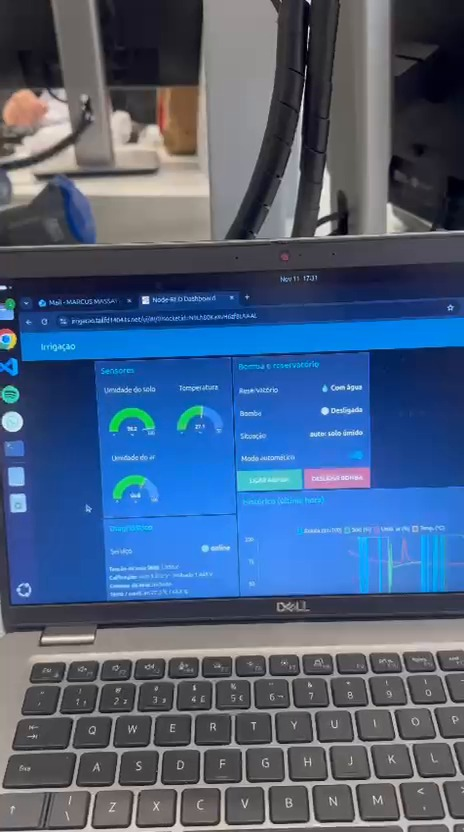
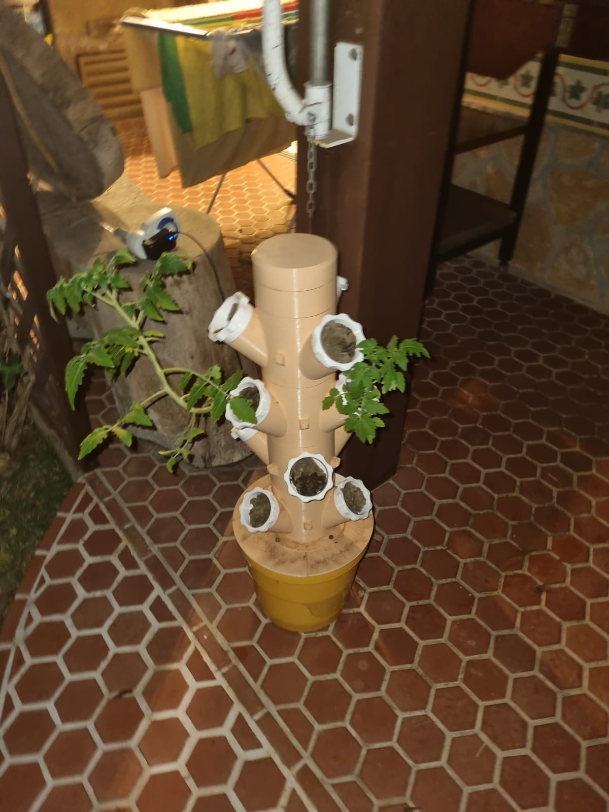
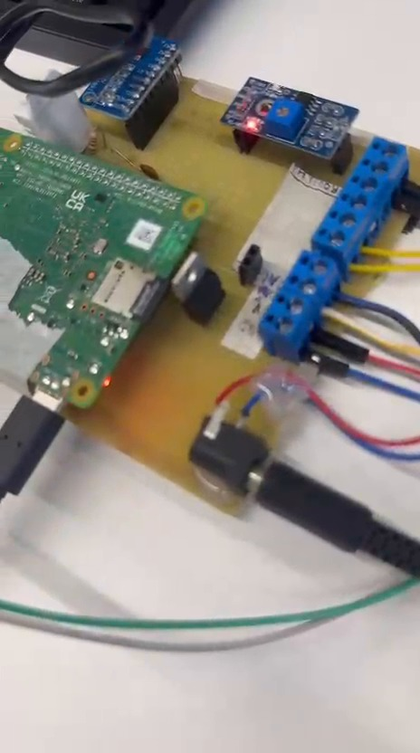
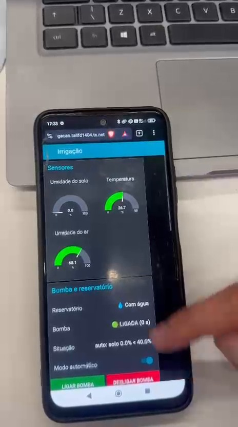

# Sistema de Irrigação Automatizada com Raspberry Pi 4

## ▶️ Assista ao projeto funcionando

### [▶ ASSISTIR AO VÍDEO ORIGINAL COMPLETO — 4 MIN 13 S](https://github.com/caiosas/irrigacao-raspberry-pi/releases/download/demonstracao-irrigacao-v1/demonstracao_completa.mp4)

**[▶ Assistir diretamente no repositório (MP4 compacto)](demonstracao.mp4)** · **[Ver a demonstração no GitHub Releases](https://github.com/caiosas/irrigacao-raspberry-pi/releases/tag/demonstracao-irrigacao-v1)**

Vídeo com a montagem do circuito, o painel em funcionamento e o acesso remoto pelo Tailscale no notebook e no celular.

---

## Integrantes

- Caio Almeida — 23.00188-7
- Enzo Arigoni — 22.01293-0
- Marcus Miyamoto — 23.01288-9
- Luiz Antônio Kastrupp — 23.01176-9

## Descrição do Projeto

Este projeto consiste no desenvolvimento de um **sistema automatizado de irrigação e monitoramento** utilizando uma **Raspberry Pi 4**. O circuito acompanha a umidade do solo, a temperatura e umidade do ar e a disponibilidade de água no reservatório para comandar uma bomba submersível de 12 V, automaticamente ou através de uma interface de controle.

O trabalho é dividido em **duas partes**, utilizando a mesma montagem e o código desenvolvido pela equipe:

1. **Parte 1 — Montagem e controle local:** construção do circuito, integração dos sensores, programação da Raspberry Pi, comunicação MQTT e controle manual/automático pelo Node-RED na rede local.
2. **Parte 2 — Disponibilização online:** configuração de **Tailscale Funnel** para acessar o mesmo dashboard remotamente pelo notebook ou celular, sem mudar o processamento ou o comando físico da bomba para um servidor externo.

O projeto utiliza o código completo da equipe, a partir do [repositório original de Marcus Miyamoto](https://github.com/marcusmmqm/irrigacao-raspberry-pi). Este repositório é um **fork** e preserva o histórico do trabalho e os arquivos existentes.

**Tecnologia utilizada para acesso remoto na Parte 2: Tailscale Funnel.**

## Aplicação do Sistema

A estrutura prevista para aplicação é uma **torre vertical de cultivo**, formada por um tubo com diversas posições de plantio. A automação pretende auxiliar o acompanhamento e acionamento da irrigação dessa estrutura.

*Estrutura vertical de cultivo apresentada pela equipe (fotografia original, sem edições).*

## Vídeo de Demonstração

O vídeo completo mostra a montagem, o funcionamento do sistema e a interface acessada remotamente. As três gravações foram reunidas na sequência original, com duração de **4 min 13 s** e áudio preservado.

- [**Vídeo original completo — MP4**](https://github.com/caiosas/irrigacao-raspberry-pi/releases/download/demonstracao-irrigacao-v1/demonstracao_completa.mp4) — 4 min 13 s, 33,7 MB, com áudio; publicado no GitHub Releases e validado por SHA-256.
- [**Versão compacta do vídeo (na raiz do repositório)**](demonstracao.mp4) — mantém toda a sequência, com qualidade de imagem e áudio reduzida para acesso mais leve.
- [**Arquivos de preservação do original**](docs/media/video_original_partes/README.md) — cópia exata dividida em 19 partes, com script para reconstruí-la e conferência de integridade.

O vídeo de 33,7 MB foi reconstruído e publicado automaticamente pelo GitHub Actions. A versão original e a cópia segmentada têm o mesmo conteúdo.

## Funcionamento Geral

1. A **Raspberry Pi 4** recebe as medições da sonda resistiva de umidade do solo pelo conversor A/D **ADS1115**, através de I²C.
2. O sensor **DHT22** informa temperatura e umidade relativa do ar.
3. Uma **boia** monitora a presença de água no reservatório.
4. O controlador [`pi/irrigacao.py`](pi/irrigacao.py) avalia os dados e aciona a bomba por meio do transistor **TIP122**.
5. No **modo automático**, um limiar de umidade e os tempos configurados definem a irrigação.
6. No **modo manual**, o operador pode comandar a bomba pelo dashboard, preservando os limites de tempo e a verificação da boia.
7. O **Mosquitto (MQTT)** transporta o estado e os comandos entre o programa Python e o painel **Node-RED**.
8. Na **segunda parte**, o **Tailscale Funnel** disponibiliza acesso HTTPS ao dashboard já instalado na Raspberry Pi.

## Lista de Materiais

| Quantidade | Componente |
|---:|---|
| 1 | Raspberry Pi 4 e fonte USB-C |
| 1 | Conversor analógico-digital ADS1115 |
| 1 | Sonda resistiva e módulo analógico de umidade do solo |
| 1 | Sensor DHT22 (temperatura e umidade do ar) |
| 1 | Boia de nível de dois fios |
| 1 | Transistor TIP122 (Darlington) |
| 1 | Bomba submersível de 12 V DC |
| 1 | Fonte de 12 V para a bomba |
| 1 | Resistor de 330 Ω (R1) |
| 1 | Resistor de 10 kΩ (R2) |
| 1 | Resistor de 4,7 kΩ (R3) |
| 1 | Capacitor cerâmico de 100 nF (C1) |
| Conforme a montagem | Fios e conectores |

Veja também [`lista_de_materiais.md`](lista_de_materiais.md).

## Ligações Principais

| Função | Conexão / pino físico da Raspberry Pi |
|---|---|
| Alimentação dos sensores | 3,3 V (pino 1) |
| GND comum | Pino 6; negativo da fonte 12 V interligado |
| ADS1115 / SDA | GPIO2 (pino 3) |
| ADS1115 / SCL | GPIO3 (pino 5) |
| Sonda de solo | AO do módulo → A0 do ADS1115 |
| DHT22 / DATA | GPIO4 (pino 7), pull-up de 4,7 kΩ |
| Boia | GPIO17 (pino 11), com pull-up interno |
| TIP122 / bomba | GPIO27 (pino 13), com R1 = 330 Ω na base e R2 = 10 kΩ para GND |

A Raspberry Pi é alimentada por USB-C e a bomba por uma fonte separada de 12 V; não foi utilizado conversor buck.

### Esquemático da montagem

[Visualizar o esquema unificado em SVG](docs/media/esquematico_unificado_sem_diodo.svg) · [Baixar a imagem em PNG](docs/media/esquematico_unificado_sem_diodo.png) · [Ver o esquema original do grupo](sch.jpeg)

**Observação:** a montagem relatada **não usou o diodo de proteção** que aparece no desenho original. O esquema unificado documenta essa informação, mas **não valida a segurança do circuito**. Uma bomba/motor pode causar surtos de tensão no desligamento; é importante definir proteção adequada e verificar a corrente e o aquecimento do TIP122 antes de energizar.

## Interface de Monitoramento

O dashboard do Node-RED exibe as medições dos sensores, a situação do reservatório, o estado da bomba e as opções de controle.

### Registros das duas etapas

**Parte 1 — Montagem e funcionamento na Raspberry Pi**

**Parte 2 — Interface online pelo Tailscale**

## Código da Raspberry Pi

O arquivo [`pi/irrigacao.py`](pi/irrigacao.py) executa a leitura dos sensores, a lógica de controle e as proteções da bomba. O projeto-base utiliza **Mosquitto/MQTT** para comunicar o programa com os fluxos do **Node-RED**.

Os parâmetros de referência documentados são: limiar de umidade **40%**, tempo de rega **10 segundos**, espera **30 segundos** e tempo máximo no manual **10 segundos**. Todos podem ser modificados após calibração.

## Como Executar

**Atualização de uma instalação existente:** depois de copiar os arquivos atualizados `pi/gerar_fluxo.py`, `pi/fluxo_irrigacao.json` e `pi/instalar_fluxo.py` para a Raspberry Pi, execute `python3 ~/irrigacao/instalar_fluxo.py` para remover os nós antigos do projeto que não fazem parte desta versão. O script realiza um backup antes do deploy. Atualizar apenas o GitHub não altera o fluxo que está rodando na Raspberry Pi.

### Parte 1 — Montagem e funcionamento local

1. Montar o circuito, conferir as ligações e avaliar a proteção da bomba.
2. Copiar os arquivos de [`pi/`](pi/) para a Raspberry Pi, na pasta `~/irrigacao`.
3. Executar `sudo bash ~/irrigacao/setup_root.sh`.
4. Depois da reinicialização, executar `cd ~/irrigacao && python3 instalar_fluxo.py`.
5. Acessar o Node-RED local pelo endereço da Raspberry Pi, na porta `1880/ui`.

[**Documentação da Parte 1 — Montagem e controle local**](docs/parte_1_montagem_e_controle.md)

### Parte 2 — Acesso online com Tailscale

1. Confirmar que o sistema local da Parte 1 está funcionando.
2. Configurar autenticação do editor e do dashboard com `python3 ~/irrigacao/node_red_senha.py`.
3. Reiniciar o Node-RED, conforme a documentação original.
4. Configurar o acesso remoto com `sudo bash ~/irrigacao/setup_funnel.sh`.
5. Testar o link HTTPS fornecido pelo Tailscale fora da rede local.

[**Documentação da Parte 2 — Acesso remoto com Tailscale**](docs/parte_2_acesso_online_tailscale.md)

**Importante:** o Tailscale permite acessar o dashboard pela internet, mas o controlador de irrigação continua executando na Raspberry Pi. Proteja o editor e o painel com senha antes de expô-los externamente.

## Arquivos do Repositório

| Arquivo / pasta | Descrição |
|---|---|
| `README.md` | Apresentação acadêmica do projeto |
| `pi/irrigacao.py` | Controle dos sensores, da bomba e comunicação MQTT |
| `pi/fluxo_irrigacao.json` | Fluxo do dashboard Node-RED |
| `pi/gerar_fluxo.py` | Gerador do fluxo Node-RED |
| `pi/instalar_fluxo.py` | Instalador do fluxo |
| `pi/setup_root.sh` | Configuração dos serviços na Raspberry Pi |
| `pi/irrigacao.service` | Serviço systemd |
| `pi/node_red_senha.py` | Autenticação do Node-RED |
| `pi/setup_funnel.sh` | Configuração do Tailscale Funnel |
| `sch.jpeg` | Esquemático original da equipe |
| `docs/dashboard.jpg` | Imagem do dashboard original |
| `docs/media/esquematico_unificado_sem_diodo.svg` | Esquema unificado representando a montagem relatada |
| `docs/media/esquematico_unificado_sem_diodo.png` | Versão PNG do esquemático |
| `docs/media/torre_vertical_aplicacao.png` | Foto original da torre de cultivo |
| `docs/media/circuito_raspberry_pi.jpg` | Registro da montagem da Raspberry Pi |
| `docs/media/painel_notebook.jpg`, `painel_celular.jpg` | Registros da interface usada na Parte 2 |
| `demonstracao.mp4` | Versão compacta de acesso rápido ao vídeo, na pasta principal |
| `docs/media/demonstracao_compacta.mp4` | Cópia da demonstração compacta, com áudio |
| `docs/media/video_original_partes/` | Vídeo original, preservado sem recompressão em 19 partes |
| `docs/media/reconstruir_video.py` | Script que recompõe e valida o MP4 original |
| `.github/workflows/publicar_video.yml` | Automação executada com sucesso para publicar o MP4 original no GitHub Releases |
| `docs/parte_1_montagem_e_controle.md` | Detalhes da Parte 1 |
| `docs/parte_2_acesso_online_tailscale.md` | Detalhes da Parte 2 |
| `docs/guia_tecnico.md` | Guia técnico da implementação local e do acesso via Tailscale |
| `lista_de_materiais.md` | Lista de componentes |

## Documentação Técnica e Créditos

A documentação de instalação, MQTT, calibração e diagnóstico está no [guia técnico do projeto](docs/guia_tecnico.md). O código-base e o histórico original permanecem acessíveis pelo link do repositório de origem.

**Repositório-base:** [marcusmmqm/irrigacao-raspberry-pi](https://github.com/marcusmmqm/irrigacao-raspberry-pi). O fork mantém o histórico e o reconhecimento do trabalho da equipe, com complementos de apresentação e documentação das duas partes.
