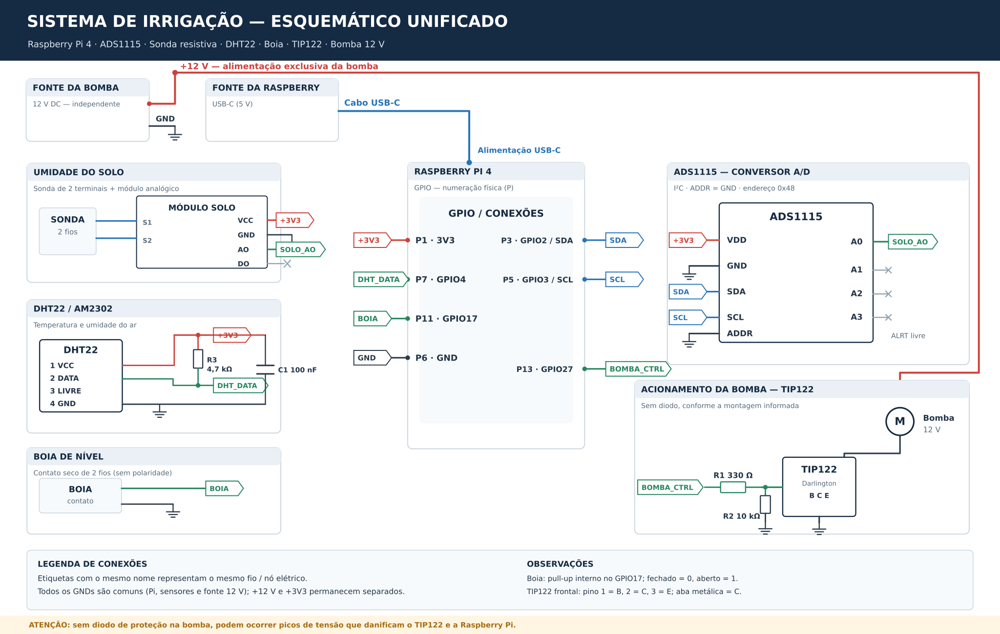
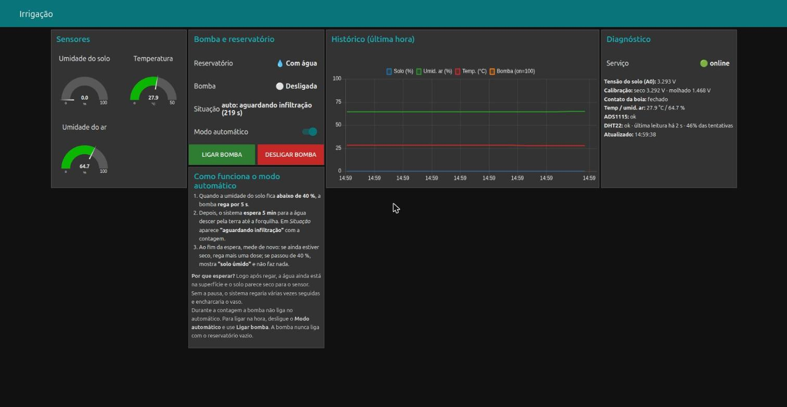

# Sistema de Irrigação Automatizada com Raspberry Pi 4

## Integrantes

Projeto desenvolvido em grupo para a disciplina de Microcontroladores. Os nomes e registros acadêmicos podem ser acrescentados quando a lista oficial da equipe estiver confirmada.

## Descrição do Projeto

Este projeto consiste no desenvolvimento de um **sistema automatizado de irrigação e monitoramento** utilizando uma **Raspberry Pi 4**. O circuito acompanha a umidade do solo, a temperatura e umidade do ar e a disponibilidade de água no reservatório para comandar uma bomba submersível de 12 V, automaticamente ou através de uma interface de controle.

O trabalho é dividido em **duas partes**, utilizando a mesma montagem e o código desenvolvido pela equipe:

1. **Parte 1 — Montagem e controle local:** construção do circuito, integração dos sensores, programação da Raspberry Pi, comunicação MQTT e controle manual/automático pelo Node-RED na rede local.
2. **Parte 2 — Disponibilização online:** configuração de **Tailscale Funnel** para acessar o mesmo dashboard remotamente pelo notebook ou celular, sem mudar o processamento ou o comando físico da bomba para um servidor externo.

O projeto utiliza o código completo da equipe, a partir do [repositório original de Marcus Miyamoto](https://github.com/marcusmmqm/irrigacao-raspberry-pi). Este repositório é um **fork** e preserva o histórico do trabalho e os arquivos existentes.

**Tecnologia efetivamente utilizada para acesso remoto: Tailscale Funnel.** A plataforma Ubidots aparece em arquivos herdados do repositório original, mas **não foi utilizada no projeto apresentado**, nem na primeira nem na segunda parte.

## Aplicação do Sistema

A estrutura prevista para aplicação é uma **torre vertical de cultivo**, formada por um tubo com diversas posições de plantio. A automação pretende auxiliar o acompanhamento e acionamento da irrigação dessa estrutura.

A fotografia da torre enviada pela equipe e os vídeos de demonstração fazem parte do conjunto de mídias preparado para este projeto. As mídias binárias ainda precisam ser incorporadas ao repositório, sem alterar o conteúdo original.

## Funcionamento Geral

1. A **Raspberry Pi 4** recebe as medições da sonda resistiva de umidade do solo pelo conversor A/D **ADS1115**, através de I²C.
2. O sensor **DHT22** informa temperatura e umidade relativa do ar.
3. Uma **boia** monitora a presença de água no reservatório.
4. O controlador [`pi/irrigacao.py`](pi/irrigacao.py) avalia os dados e aciona a bomba por meio do transistor **TIP122**.
5. No **modo automático**, um limiar de umidade e os tempos configurados definem a irrigação.
6. No **modo manual**, o operador pode comandar a bomba pelo dashboard, preservando os limites de tempo e a verificação da boia.
7. O **Mosquitto (MQTT)** transporta o estado e os comandos entre o programa Python e o painel **Node-RED**.
8. Na **segunda parte**, o **Tailscale Funnel** disponibiliza acesso HTTPS ao dashboard já instalado na Raspberry Pi.

## Lista de Materiais

| Quantidade | Componente |
|---:|---|
| 1 | Raspberry Pi 4 e fonte USB-C |
| 1 | Conversor analógico-digital ADS1115 |
| 1 | Sonda resistiva e módulo analógico de umidade do solo |
| 1 | Sensor DHT22 (temperatura e umidade do ar) |
| 1 | Boia de nível de dois fios |
| 1 | Transistor TIP122 (Darlington) |
| 1 | Bomba submersível de 12 V DC |
| 1 | Fonte de 12 V para a bomba |
| 1 | Resistor de 330 Ω (R1) |
| 1 | Resistor de 10 kΩ (R2) |
| 1 | Resistor de 4,7 kΩ (R3) |
| 1 | Capacitor cerâmico de 100 nF (C1) |
| Conforme a montagem | Fios e conectores |

Veja também [`lista_de_materiais.md`](lista_de_materiais.md).

## Ligações Principais

| Função | Conexão / pino físico da Raspberry Pi |
|---|---|
| Alimentação dos sensores | 3,3 V (pino 1) |
| GND comum | Pino 6; negativo da fonte 12 V interligado |
| ADS1115 / SDA | GPIO2 (pino 3) |
| ADS1115 / SCL | GPIO3 (pino 5) |
| Sonda de solo | AO do módulo → A0 do ADS1115 |
| DHT22 / DATA | GPIO4 (pino 7), pull-up de 4,7 kΩ |
| Boia | GPIO17 (pino 11), com pull-up interno |
| TIP122 / bomba | GPIO27 (pino 13), com R1 = 330 Ω na base e R2 = 10 kΩ para GND |

A Raspberry Pi é alimentada por USB-C e a bomba por uma fonte separada de 12 V; não foi utilizado conversor buck.

### Esquemático da montagem

[Visualizar o esquema unificado em SVG](docs/media/esquematico_unificado_sem_diodo.svg) · [Ver o esquema original do grupo](sch.jpeg)

**Observação:** a montagem relatada **não usou o diodo de proteção** que aparece no desenho original. O esquema unificado documenta essa informação, mas **não valida a segurança do circuito**. Uma bomba/motor pode causar surtos de tensão no desligamento; é importante definir proteção adequada e verificar a corrente e o aquecimento do TIP122 antes de energizar.

## Interface de Monitoramento

O dashboard do Node-RED exibe as medições dos sensores, a situação do reservatório, o estado da bomba e as opções de controle.

## Código da Raspberry Pi

O arquivo [`pi/irrigacao.py`](pi/irrigacao.py) executa a leitura dos sensores, a lógica de controle e as proteções da bomba. O projeto-base utiliza **Mosquitto/MQTT** para comunicar o programa com os fluxos do **Node-RED**.

Os parâmetros de referência documentados são: limiar de umidade **40%**, tempo de rega **10 segundos**, espera **30 segundos** e tempo máximo no manual **10 segundos**. Todos podem ser modificados após calibração.

## Como Executar

### Parte 1 — Montagem e funcionamento local

1. Montar o circuito, conferir as ligações e avaliar a proteção da bomba.
2. Copiar os arquivos de [`pi/`](pi/) para a Raspberry Pi, na pasta `~/irrigacao`.
3. Executar `sudo bash ~/irrigacao/setup_root.sh`.
4. Depois da reinicialização, executar `cd ~/irrigacao && python3 instalar_fluxo.py`.
5. Acessar o Node-RED local pelo endereço da Raspberry Pi, na porta `1880/ui`.

[**Documentação da Parte 1 — Montagem e controle local**](docs/parte_1_montagem_e_controle.md)

### Parte 2 — Acesso online com Tailscale

1. Confirmar que o sistema local da Parte 1 está funcionando.
2. Configurar autenticação do editor e do dashboard com `python3 ~/irrigacao/node_red_senha.py`.
3. Reiniciar o Node-RED, conforme a documentação original.
4. Configurar o acesso remoto com `sudo bash ~/irrigacao/setup_funnel.sh`.
5. Testar o link HTTPS fornecido pelo Tailscale fora da rede local.

[**Documentação da Parte 2 — Acesso remoto com Tailscale**](docs/parte_2_acesso_online_tailscale.md)

**Importante:** o Tailscale permite acessar o dashboard pela internet, mas o controlador de irrigação continua executando na Raspberry Pi. Proteja o editor e o painel com senha antes de expô-los externamente.

## Arquivos do Repositório

| Arquivo / pasta | Descrição |
|---|---|
| `README.md` | Apresentação acadêmica do projeto |
| `pi/irrigacao.py` | Controle dos sensores, da bomba e comunicação MQTT |
| `pi/fluxo_irrigacao.json` | Fluxo do dashboard Node-RED |
| `pi/gerar_fluxo.py` | Gerador do fluxo Node-RED |
| `pi/instalar_fluxo.py` | Instalador do fluxo |
| `pi/setup_root.sh` | Configuração dos serviços na Raspberry Pi |
| `pi/irrigacao.service` | Serviço systemd |
| `pi/node_red_senha.py` | Autenticação do Node-RED |
| `pi/setup_funnel.sh` | Configuração do Tailscale Funnel |
| `ubidots/` | Arquivos legados do repositório-base — **não utilizados neste projeto** |
| `sch.jpeg` | Esquemático original da equipe |
| `docs/dashboard.jpg` | Imagem do dashboard original |
| `docs/media/esquematico_unificado_sem_diodo.svg` | Esquema unificado representando a montagem relatada |
| `docs/parte_1_montagem_e_controle.md` | Detalhes da Parte 1 |
| `docs/parte_2_acesso_online_tailscale.md` | Detalhes da Parte 2 |
| `docs/README_TECNICO_ORIGINAL.md` | Documentação técnica completa do projeto-base |
| `lista_de_materiais.md` | Lista de componentes |

## Documentação Técnica e Créditos

A descrição detalhada de instalação, MQTT, calibração e diagnóstico foi preservada integralmente no [README técnico original](docs/README_TECNICO_ORIGINAL.md). Esse documento é um registro do projeto-base e contém referências à alternativa Ubidots, **que não foi implementada nem utilizada pela nossa equipe**.

**Repositório-base:** [marcusmmqm/irrigacao-raspberry-pi](https://github.com/marcusmmqm/irrigacao-raspberry-pi). O fork mantém o histórico e o reconhecimento do trabalho da equipe, com complementos de apresentação e documentação das duas partes.
