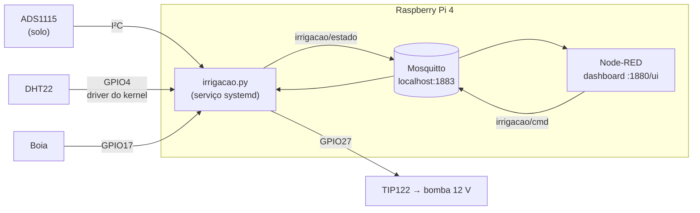
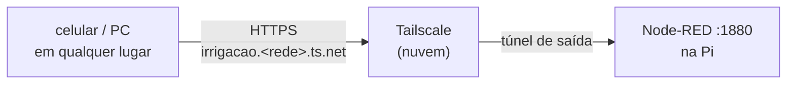

# Guia técnico — Irrigação com Raspberry Pi 4 + Node-RED

Este guia documenta a implementação de controle local e a publicação remota via Tailscale. A base técnica vem do [repositório original do grupo](https://github.com/marcusmmqm/irrigacao-raspberry-pi); o histórico completo permanece disponível no fork.

Sistema de irrigação para a disciplina de microcontroladores. A Raspberry Pi 4 lê a umidade do solo, a temperatura e a umidade do ar e o nível do reservatório. Com essas leituras ela aciona uma bomba de 12 V, sozinha (modo automático) ou pelo dashboard do Node-RED (modo manual).


## Acesso rápido

| O quê | Endereço |
|---|---|
| **SSH** | `ssh pi@10.33.133.22` (ou `ssh pi@raspberrypi.local`) |
| **Dashboard** | http://10.33.133.22:1880/ui |
| **Editor do Node-RED** | http://10.33.133.22:1880 |
| **De qualquer lugar (internet)** | `https://irrigacao.<sua-rede>.ts.net/ui`. Veja [Acesso pela internet](#acesso-pela-internet-tailscale-funnel) |

### Rede Wi-Fi

> O IP **10.33.133.22** é atribuído por DHCP e pode mudar.
> Se não responder, tente `raspberrypi.local`. Também dá para procurar a Pi na rede com
> `nmap -sn 10.33.133.0/24` e ver os MACs que começam com `2c:cf:67` (Raspberry Pi).
> O acesso é por chave SSH. O `sudo` pede senha, exceto para reiniciar os serviços do projeto (veja [Operação](#operação)).

## Hardware

O esquema original está em [`sch.jpeg`](../sch.jpeg) e o esquema da montagem relatada em [media/esquematico_unificado_sem_diodo.svg](media/esquematico_unificado_sem_diodo.svg). Ele usa duas fontes (USB-C da Pi + 12 V da bomba), não tem conversor buck e todos os GNDs são comuns.

| Componente | Ligação na Pi (pino **físico**) | Observação |
|---|---|---|
| Alimentação 3,3 V | 1 (3V3) | ADS1115, plaquinha do solo, DHT22 |
| GND comum | 6 | inclui o negativo da fonte de 12 V |
| ADS1115 (I²C) | 3 (SDA) · 5 (SCL) | ADDR no GND → endereço `0x48`; A0 = umidade do solo |
| Sonda de solo (forquilha + plaquinha) | A0 do ADS1115 | plaquinha em 3,3 V; DO livre |
| DHT22 | 7 (GPIO4) | pull-up R3 = 4,7 kΩ, C1 = 100 nF |
| Boia (contato seco) | 11 (GPIO17) | pull-up interno; contato fechado = 0 |
| Bomba 12 V via TIP122 | 13 (GPIO27) | R1 = 330 Ω na base, R2 = 10 kΩ base→GND, montagem relatada sem diodo; avaliar proteção contra surtos antes de energizar |

A bomba é uma **AD20P brushless submersível**. Ela tem polaridade (vermelho no +12 V, preto no coletor do TIP122) e **não pode rodar a seco**. O negativo da fonte de 12 V vai direto ao emissor do TIP122, e desse mesmo ponto sai um fio fino até o GND da Pi. Assim a corrente da bomba não passa pelo GND dos sensores.

Os pinos físicos 2 e 4 (5 V) **ficam livres**.

## Arquitetura



- **`irrigacao.py`** é o "cérebro": lê os sensores, decide quando regar e controla a bomba. **As travas de segurança ficam aqui**, não no dashboard, então valem mesmo se o Node-RED cair.
- **Node-RED** é só a interface: mostra os dados e envia comandos via MQTT.
- **DHT22** é lido pelo driver do kernel (`dtoverlay=dht11,gpiopin=4`, que também atende o DHT22). Isso dispensa bibliotecas Python de bit-banging.
- **ADS1115** é lido direto por `smbus2`, em single-shot, com ganho ±4,096 V e média de 4 amostras.

### Segurança da bomba

- A bomba **nunca liga sem água** no reservatório (boia), e desliga se a água acabar. A boia é verificada a cada 0,5 s e só muda de estado depois de **3 s estável**. Sem esse filtro, a água agitada pela própria bomba balançava o flutuador e cortava a bomba na partida.
- **Modo manual:** a bomba desliga sozinha após `tempo_max_manual` segundos. Também desliga se a conexão MQTT cair.
- **Modo automático:** quando o solo fica abaixo do `limiar`, a bomba rega por `tempo_rega` s e depois espera `tempo_espera` s para a água infiltrar antes de medir de novo.
- Se o serviço parar ou travar, o GPIO27 é liberado e o **R2 de 10 kΩ** mantém a base do TIP122 em 0, ou seja, a bomba fica desligada.

## MQTT

| Tópico | Direção | Conteúdo |
|---|---|---|
| `irrigacao/estado` | Pi → dashboard (retido, a cada ~2 s) | JSON com `solo_v`, `solo_pct`, `temp`, `umid_ar`, `tem_agua`, `bomba`, `motivo`, `erros`, `cfg`… |
| `irrigacao/cmd` | dashboard → Pi | JSON com um ou mais comandos (abaixo) |

```jsonc
{"modo": "auto"}                 // ou "manual"
{"regar": true}                  // uma dose de tempo_rega s, em qualquer modo; bloqueado sem água
{"bomba": true}                  // liga contínuo, só no manual, até tempo_max_manual; bloqueado sem água
{"bomba": false}                 // para a bomba em qualquer modo
{"limiar": 40}                   // % de umidade do solo para regar
{"tempo_rega": 10, "tempo_espera": 30, "tempo_max_manual": 10}
{"calibrar": "seco"}             // ou "molhado": grava a tensão atual do solo
{"boia_fechada_tem_agua": true}  // inverte a lógica da boia
```

Teste pelo terminal da Pi:

```bash
mosquitto_sub -h localhost -t irrigacao/estado -C 1     # ver estado
mosquitto_pub -h localhost -t irrigacao/cmd -m '{"modo":"manual"}'
```

A configuração fica salva em `~/irrigacao/config.json` (modelo em [`pi/config.example.json`](../pi/config.example.json)).

## Acesso pela internet (Tailscale Funnel)

O dashboard do Node-RED fica acessível de qualquer lugar, por HTTPS, num endereço fixo `https://irrigacao.<sua-rede>.ts.net/ui`. O [Tailscale Funnel](https://tailscale.com/kb/1223/funnel) é gratuito no plano *Personal* (uso não comercial). A Pi só abre uma conexão de **saída** até o Tailscale, então funciona atrás da rede da faculdade, sem IP público e sem abrir porta no roteador.



**Antes de publicar, coloque senha no Node-RED.** Sem senha, qualquer pessoa com o link poderia abrir o editor e rodar comandos na Pi, por exemplo com o nó `exec`.

| Onde | Usuário | Proteção |
|---|---|---|
| Editor (`/`) | `admin` | `adminAuth` (login do Node-RED) |
| Dashboard (`/ui`) | `irrigacao` | `httpNodeAuth` (o navegador pede usuário e senha) |

As travas da bomba (boia, tempo máximo) continuam no `irrigacao.py`, então valem também para quem usa o dashboard pela internet.

### Passo a passo (na Pi)

```bash
# 1. senha no editor e no dashboard (só os hashes bcrypt ficam em ~/.node-red/irrigacao-auth.js)
sudo apt install -y python3-bcrypt
python3 ~/irrigacao/node_red_senha.py
sudo systemctl restart nodered

# 2. Tailscale + Funnel na porta 1880
sudo bash ~/irrigacao/setup_funnel.sh
```

O `setup_funnel.sh`:
1. instala o Tailscale;
2. mostra um link para você entrar na sua conta (pode ser a do Google ou a do GitHub);
3. liga o Funnel e imprime o endereço final.

Na primeira vez, o Tailscale pede para ativar **HTTPS** e **Funnel** no painel web. O link aparece no terminal: ative e rode o script de novo. O Funnel continua ligado depois de reiniciar a Pi. Para desligar: `sudo tailscale funnel reset`.

Com a senha ligada, o `instalar_fluxo.py` pede o usuário e a senha do editor. Também dá para passar por variáveis de ambiente: `NODERED_USER=admin NODERED_PASS=... python3 instalar_fluxo.py`.

## Calibração da umidade do solo

A plaquinha entrega **tensão alta com o solo seco** e **baixa com o solo molhado**. O percentual é calculado linearmente entre as duas tensões de referência:

| Referência | Tensão calibrada |
|---|---|
| Seco (forquilha seca, no ar) | 3,292 V → 0 % |
| Molhado (forquilha na água) | 1,468 V → 100 % |

O dashboard não tem botões de configuração. Para recalibrar, coloque a forquilha na condição desejada e rode na Pi:

```bash
mosquitto_pub -h localhost -t irrigacao/cmd -m '{"calibrar":"seco"}'     # forquilha seca/no ar
mosquitto_pub -h localhost -t irrigacao/cmd -m '{"calibrar":"molhado"}'  # forquilha na água
```

O painel *Diagnóstico* mostra a tensão do A0 em tempo real.

## Valores de controle

| Parâmetro | Valor | Motivo |
|---|---|---|
| `limiar` | 40 % | terra seca lê ~10–30 %, recém-regada ~60–90 % |
| `tempo_rega` | 10 s | dose de rega do automático (a AD20P bombeia até ~4 L/min: ≈ até 650 mL) |
| `tempo_espera` | 30 s | pausa para a água infiltrar antes de medir de novo |
| `tempo_max_manual` | 10 s | o botão "Ligar bomba" no manual também rega 10 s e desliga sozinho |

Para mudar um valor: `mosquitto_pub -h localhost -t irrigacao/cmd -m '{"limiar": 45}'`.

## Instalação do zero

Testado em Raspberry Pi OS / Debian 13 (trixie), com Node-RED 5 e `node-red-dashboard` 3.6 já instalados.

```bash
# no notebook: copiar os arquivos
ssh pi@10.33.133.22 'mkdir -p ~/irrigacao'
scp pi/* pi@10.33.133.22:irrigacao/

# na Pi: tudo que precisa de root (I2C, overlay do DHT22, mosquitto,
# serviço systemd, Node-RED no boot, sudoers restrito). Reinicia no fim.
sudo bash ~/irrigacao/setup_root.sh

# na Pi, depois do reboot: instalar a aba "Irrigação" no Node-RED
cd ~/irrigacao && python3 instalar_fluxo.py
```

Para o acesso pela internet, veja [Acesso pela internet (Tailscale Funnel)](#acesso-pela-internet-tailscale-funnel).

`instalar_fluxo.py` usa a Admin API do Node-RED. Antes de alterar qualquer coisa ele salva um backup dos fluxos (`backup_flows_*.json`). Ele **desativa** (sem apagar) as abas antigas que usam `rpi-gpio`, porque uma delas usava o pino físico 3, que é o SDA do ADS1115.

Para alterar o dashboard, edite `pi/gerar_fluxo.py`, rode `python3 pi/gerar_fluxo.py` para gerar `fluxo_irrigacao.json`, copie para a Pi e rode `instalar_fluxo.py` de novo.

## Operação

```bash
sudo systemctl restart irrigacao     # sem senha (regra em /etc/sudoers.d/020_irrigacao)
sudo systemctl restart nodered       # sem senha
journalctl -u irrigacao -f           # log do serviço (bomba liga/desliga, comandos)
/usr/sbin/i2cdetect -y 1             # deve mostrar 48
cat /sys/bus/iio/devices/iio:device0/in_temp_input   # DHT22 em m°C
pinctrl get 4,17,27                  # estado dos pinos
```

## Arquivos

| Arquivo | Função |
|---|---|
| `pi/irrigacao.py` | serviço: sensores, controle, segurança, MQTT |
| `pi/irrigacao.service` | unidade systemd (roda como `pi`) |
| `pi/setup_root.sh` | configuração única com root |
| `pi/node_red_senha.py` | liga a senha do editor e do dashboard do Node-RED |
| `pi/setup_funnel.sh` | instala o Tailscale e publica o Node-RED na internet (Funnel) |
| `pi/instalar_fluxo.py` | instala o fluxo via Admin API (com backup) |
| `pi/config.example.json` | configuração de exemplo |
| `sch.jpeg` | esquema elétrico |

## Problemas encontrados na montagem (e diagnóstico)

- **Nenhum sensor respondia:** o 3,3 V e/ou o GND não chegavam à placa. Pistas usadas: `i2cdetect` vazio, DHT22 com *timeout*, GPIO4 em 0 mesmo com o pull-up externo e a boia sempre em 1.
- **A0 fixo em 0,004 V** enquanto A1–A3 (soltos) davam ~0,91 V: o fio do AO estava ligado, mas a plaquinha do solo estava sem alimentação.
- **A0 travado em ~3,29 V** com a forquilha seca ou na água: havia uma trilha ligando um polo da forquilha ao VCC, o que prendia o AO no 3,3 V. A forquilha deve ir **só** aos 2 pinos de entrada da plaquinha. Depois de corrigir, a leitura passou a 1,47 V na água.
- **DHT22 com erro intermitente:** na Pi 4, o driver do kernel falha em ~50 % das leituras, porque interrupções atrapalham a temporização de microssegundos. As leituras que passam são válidas (o checksum é conferido). O serviço respeita ≥ 2 s entre tentativas e só reporta erro após 30 s sem nenhuma leitura boa.
- **A bomba era cortada na partida:** a boia oscilava por frações de segundo logo que o motor ligava (flutuador balançando com a água agitada e/ou ruído da partida). Resolvido com o filtro de 3 s. Se ainda houver ruído, dá para pôr um capacitor de 100 nF entre o GPIO17 e o GND e afastar o fio da boia dos fios da bomba.
- Boia e forquilha **não têm polaridade**. A plaquinha do solo, o DHT22 e o ADS1115 **têm** (VCC/GND).
