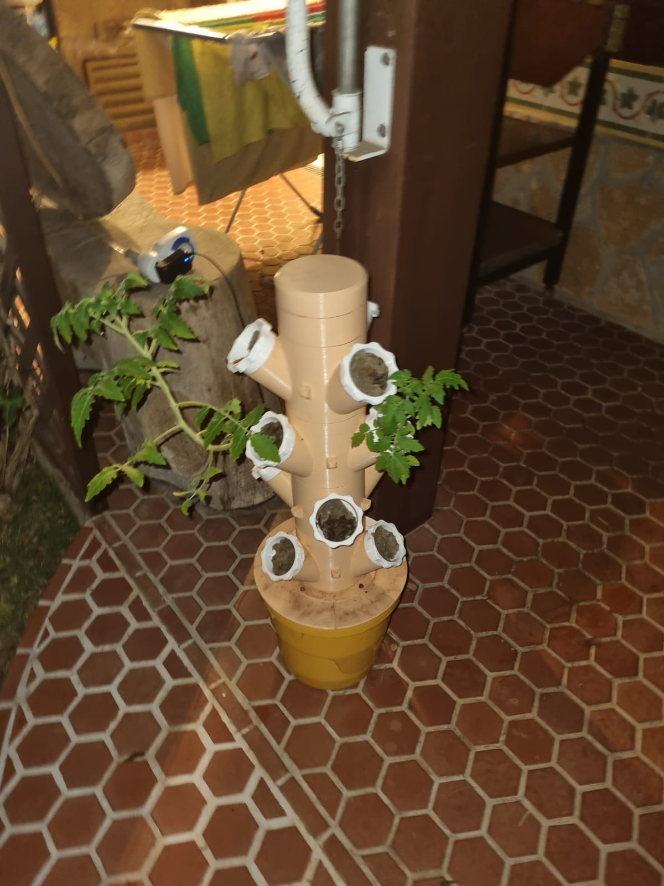
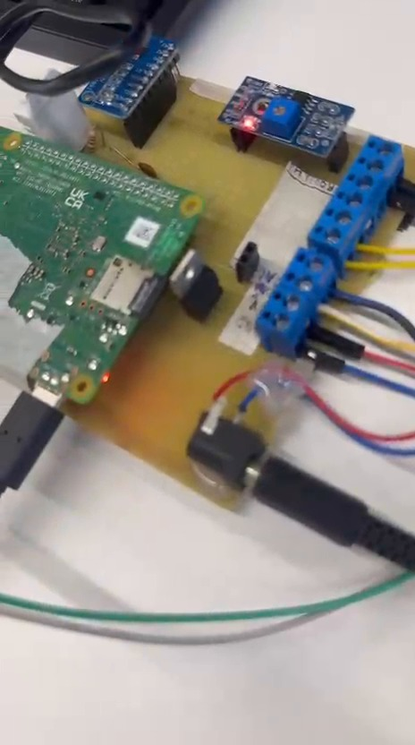

# Parte 1 — Montagem e funcionamento local

## Objetivo

Construir o circuito de irrigação, realizar a leitura dos sensores e demonstrar o acionamento da bomba pela Raspberry Pi 4 em modo manual e automático, usando um painel Node-RED acessível na rede local.

Esta é a **primeira parte** do projeto, dedicada à montagem física, às conexões elétricas, à leitura dos sensores e à programação do controle local. O acesso externo por Tailscale pertence à [Parte 2](parte_2_acesso_online_tailscale.md).

## Hardware

| Componente | Função e conexão |
|---|---|
| Raspberry Pi 4 | Controlador central do sistema |
| ADS1115 | Conversão A/D da sonda resistiva de solo, I²C no endereço `0x48` (SDA: GPIO2, SCL: GPIO3) |
| Sonda resistiva | Saída AO conectada ao canal A0 do ADS1115; módulo em 3,3 V |
| DHT22 | Temperatura e umidade relativa do ar; DATA no GPIO4 (pino físico 7) |
| Boia de nível | Contato seco no GPIO17 (pino físico 11), com pull-up interno |
| TIP122 | Acionamento da bomba pelo GPIO27 (pino físico 13) |
| Bomba 12 V DC | Irrigação da estrutura de cultivo, com alimentação independente |

A Raspberry Pi é alimentada pela fonte USB-C. A bomba recebe 12 V de fonte separada e ambas compartilham referência de GND. O TIP122 utiliza **R1 de 330 Ω** na base e **R2 de 10 kΩ** da base ao GND; o DHT22 utiliza **R3 de 4,7 kΩ** como pull-up e **C1 de 100 nF** entre alimentação e GND, perto do sensor.

Veja o [diagrama unificado de conexão sem diodo](media/esquematico_unificado_sem_diodo.svg), preparado para documentar a montagem informada pela equipe. O arquivo anterior de desenho, que mostrava um diodo não instalado, permanece acessível no histórico do repositório original, mas não integra esta versão.

> **Segurança:** o grupo informou que não montou o diodo em paralelo com a bomba. Isso documenta a montagem, **não é uma recomendação elétrica**. Um motor/carga indutiva pode gerar surtos capazes de danificar o transistor. Antes de energizar, avaliar proteção adequada, corrente de partida e aquecimento do TIP122.

## Software e controle local

O controlador [`pi/irrigacao.py`](../pi/irrigacao.py) coleta leituras, verifica a boia e comanda a bomba. Os estados são publicados no tópico MQTT `irrigacao/estado` e os comandos do Node-RED chegam em `irrigacao/cmd`.

- **Modo automático:** usa um limiar de umidade e intervalos de rega e espera para decidir o acionamento.
- **Modo manual:** permite comandos pelo dashboard, sem desativar as travas de proteção do programa.
- **Proteções previstas no código-base:** bloqueio por ausência de água, limite de duração de acionamento manual e desligamento em determinadas falhas de comunicação.

Na configuração documentada pelo projeto-base, os valores iniciais são: limiar **40%**, rega **10 s**, espera **30 s** e tempo máximo manual **10 s**. São parâmetros configuráveis, sujeitos a calibração.

## Instalação

Com os arquivos da pasta `pi/` copiados para `~/irrigacao` na Raspberry Pi:

```bash
sudo bash ~/irrigacao/setup_root.sh
# após a reinicialização
cd ~/irrigacao
python3 instalar_fluxo.py
```

Na rede local, abra `http://<IP_DA_RASPBERRY>:1880/ui`. A configuração completa do sistema, os comandos de diagnóstico, a calibração da sonda e os detalhes de segurança estão no [README técnico original preservado](guia_tecnico.md).

## Aplicação física

A estrutura escolhida como aplicação é uma torre vertical de cultivo, com pontos de plantio ao longo do tubo. A fotografia original fornecida pela equipe está disponível no repositório, **sem modificações**:



### Registro da montagem



A demonstração do funcionamento está disponível na [página principal do projeto](../README.md).