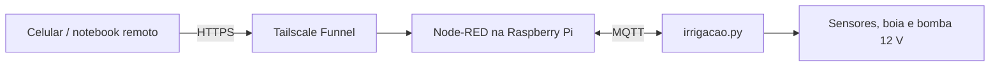
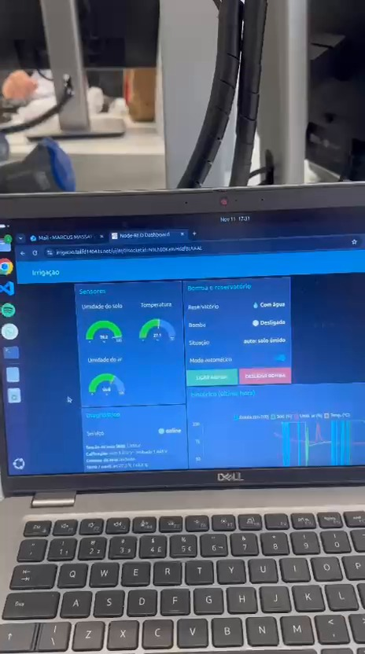
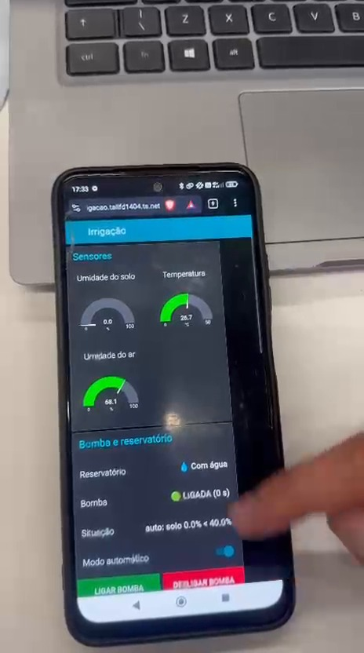

# Parte 2 — Acesso online com Tailscale

## Objetivo

Permitir que o sistema de irrigação construído na **Parte 1** possa ser monitorado e comandado remotamente, pelo celular ou notebook fora da rede local.

O projeto **não transfere o controle da bomba para um servidor na nuvem**: a Raspberry Pi continua lendo sensores, executando a lógica de irrigação e protegendo a bomba. A segunda etapa configura um caminho HTTPS para o dashboard local através do **Tailscale Funnel**.

## Arquitetura



O programa Python e o Node-RED continuam executando no hardware da Parte 1. O MQTT local conecta o painel à lógica de controle.

## Preparação

1. Confirmar que a Parte 1 está operando corretamente na rede local.
2. Configurar autenticação para o editor **e** para o dashboard Node-RED.
3. Instalar/configurar o Tailscale na Raspberry Pi e habilitar o Funnel.
4. Testar o endereço HTTPS gerado fora da rede local, por exemplo com o smartphone sem o Wi-Fi.
5. Confirmar que os modos manual e automático mantêm os limites do controlador da Raspberry Pi.

Os scripts de configuração já existem no repositório original, dentro de `pi/`. Na Pi, conforme o procedimento documentado pela equipe:

```bash
python3 ~/irrigacao/node_red_senha.py
sudo systemctl restart nodered
sudo bash ~/irrigacao/setup_funnel.sh
```

O endereço do dashboard terá o padrão `https://irrigacao.<sua-rede>.ts.net/ui`, conforme a configuração da rede Tailscale.

## Segurança

- Não disponibilize o **editor** do Node-RED na internet sem senha. Ele pode executar ações na Raspberry Pi.
- Proteja também o **dashboard**: HTTPS criptografa a conexão, mas não autentica o usuário por si só.
- Não publique tokens, senhas, chaves SSH ou configurações privadas neste repositório.
- As verificações de nível de água e limites de acionamento devem continuar funcionando independentemente de acesso remoto.

## Tecnologia efetivamente utilizada

**Somente o Tailscale Funnel foi utilizado para disponibilizar o painel online nesta segunda etapa.** Os arquivos `ubidots/` e as referências a Ubidots existentes no código e na documentação herdados são materiais do repositório original, não fazem parte da implementação apresentada pela equipe.

## Demonstração do acesso remoto

Os registros abaixo mostram o painel usado nesta segunda etapa no notebook e no celular, com acesso remoto por Tailscale.





[Assistir ao vídeo original completo](https://github.com/caiosas/irrigacao-raspberry-pi/releases/download/demonstracao-irrigacao-v1/demonstracao_completa.mp4) · [Versão compacta](media/demonstracao_compacta.mp4)


Para os detalhes técnicos de instalação e manutenção, veja o [README técnico original](README_TECNICO_ORIGINAL.md).